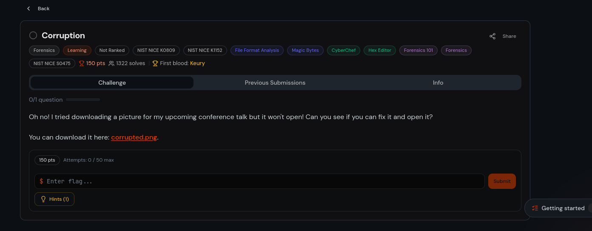
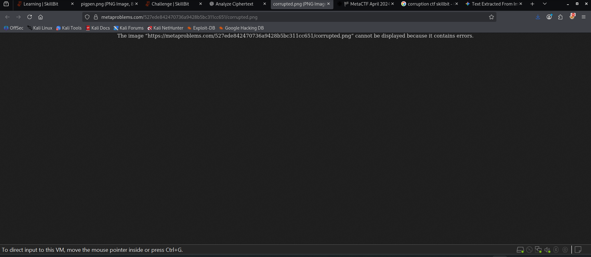
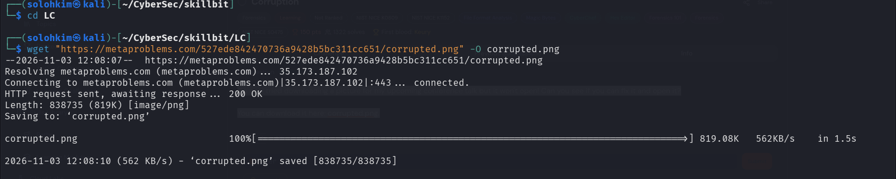
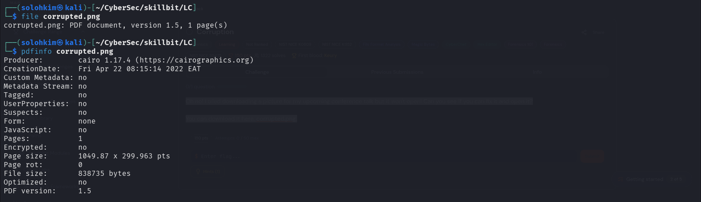
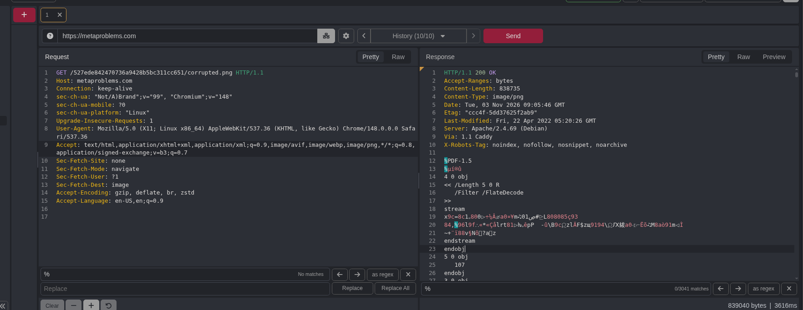
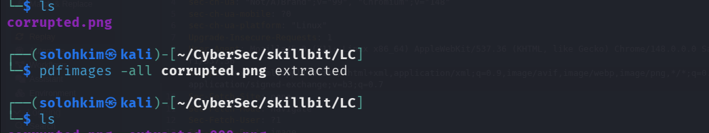
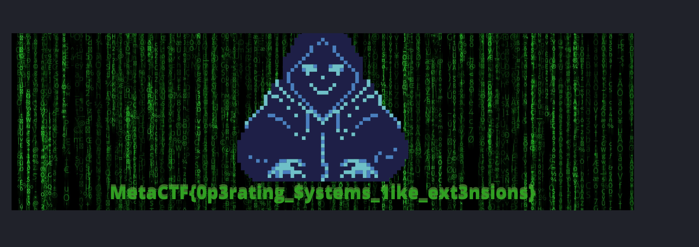

***CORRUPTION WRITEUP----*** from skillbit


QZ:

Oh no! I tried downloading a picture for my upcoming conference talk but it won't open! Can you see if you can fix it and open it?

You can download it here: corrupted.png.



From the web we can see it's already broken



so i downloaded the corrupted.png file 
using 
```bash
wget $BASH_COMMAND
```



I listed the contents
and discoved the details using info command 




Using pdfdetach, i checked if we had any embeddedfiles
```bash
                                                                                                                                                            
┌──(solohkim㉿kali)-[~/CyberSec/skillbit/LC]
└─$ pdfdetach -list corrupted.png
0 embedded files

```

Upon using a web fuzzer, i saw something here



After discovering this i had to extract the pdf items using this command:

```bash
pdfimages -all corrupted.png extracted
```


After extracting i realized something interesting:


Then i opened the extracted-000.png file
using this command
```bash
xdg-open extracted-000.png
```

And boom here is our flag:




```bash
Flag: MetaCTF{0p3rating_$ystems_1ike_ext3nsions}
```


