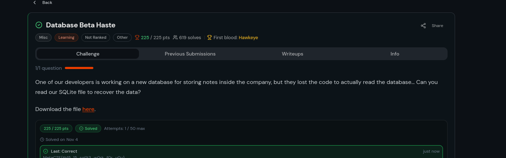
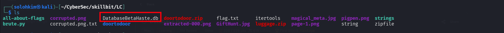
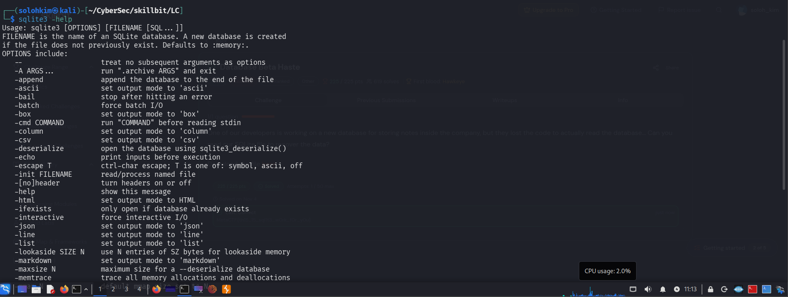
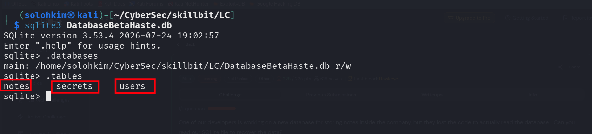
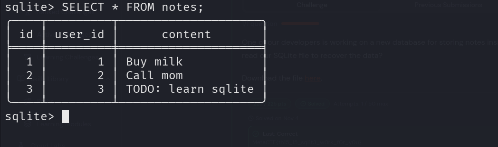
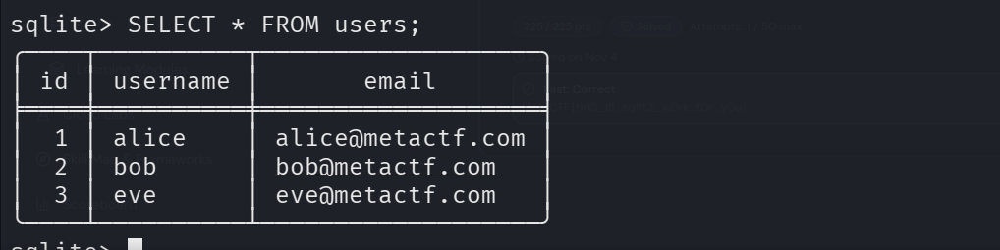
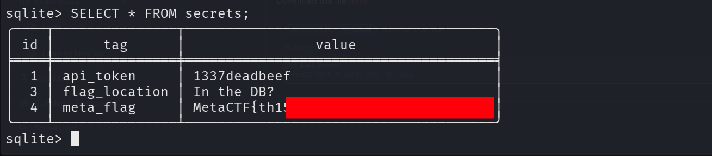

***Database Beta Haste** ---Skillbit walkthrough and writeup


QZ
One of our developers is working on a new database for storing notes inside the company, but they lost the code to actually read the database... Can you read our SQLite file to recover the data?

Download the file here.




I started by downloading the db files for analysis



From the challenge it's clear that we are anlyzing database files and logs
so we can utilize sqlite for our lab

We have the following options


Now let's get started
First let's see the available databases and tables using the following command
```bash
sqlite3 databasebetahaste.db
```
Great, from the output we have following tables:
```bash
notes
users
secrets
```


Let's look at each one of them, but interestingly, the secrets tables got my eye 👁️
1. Notes table
```bash
SELECT * FROM notes;
```

Nothing really important from notes table

2. Users table
```bash
SELECT * FROM users;
```
here we get 
-alice
-bob
-eve



Finally let's enumerate secrets table, it's interesting

```bash
SELECT * FROM secrets;
```


And boom we have the metaflag
This was an easy db pentest
Glad you enjoyed

👍


