***Flash CTF - Dead Drop***

Welcome
First of all we want to grab the files from the lab

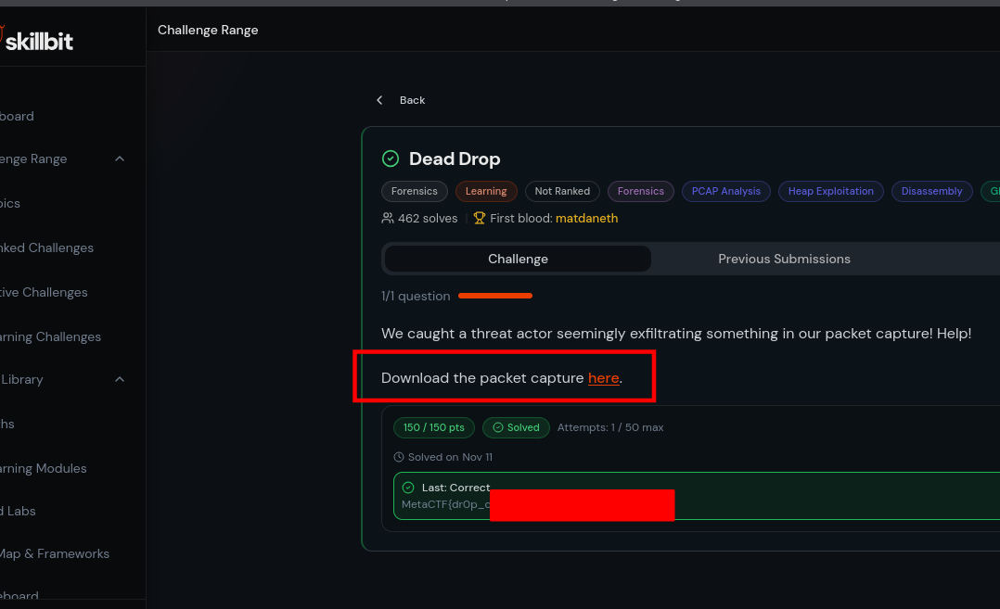

This challenge is in the Forensics category. We're told it's a packet capture or "PCAP" challenge, and that a threat actor was caught "seemingly exfiltrating something".

This is a fairly common setup for a PCAP forensics challenge. It usually means that it'll be fairly easy, and that there's just some data being transferred at some point in the file that contains the flag in some way - either directly, or encoded in some manner.

As with most packet capture challenges, let's start by opening it in Wireshark, a free program for creating and analyzing network packet captures.

```bash
wireshark deaddrop.pcap
```
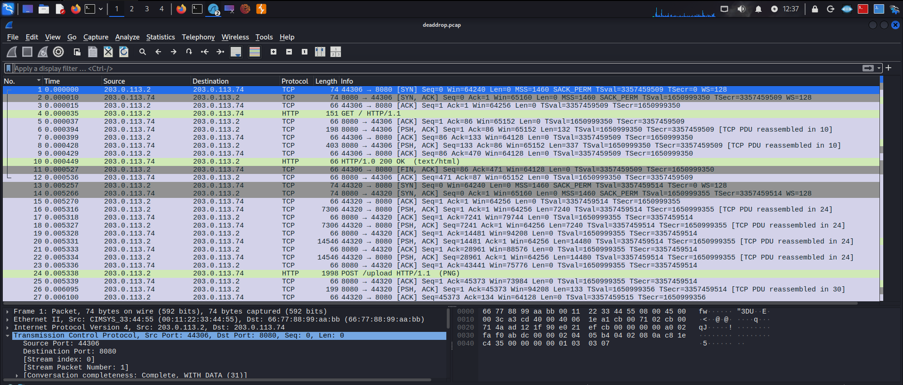

This is a pretty simple PCAP. Only 32 packets - it almost all fits on my screen. If we click around the packets, we can see with the bar on the left that there are only two TCP connections (aka conversations, streams, etc) that were captured here:

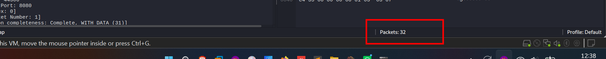

It looks like both were simple HTTP requests and responses. Let's filter for http to hide all the TCP noise and show just the high-level information.

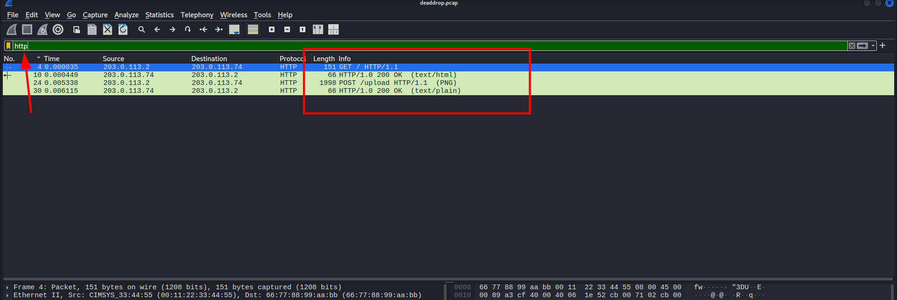

From just this view, it looks like the user GET requested a page from a website (just /, the root URL), then POST uploaded some sort of data (we can assume, as the length of the POST is almost 2000 bytes) to the /upload URL. Wireshark even conveniently tells us that a PNG file was uploaded.

If we click on the first 200 OK and look in the bottom-left pane, we can see the HTML contents of the webpage:

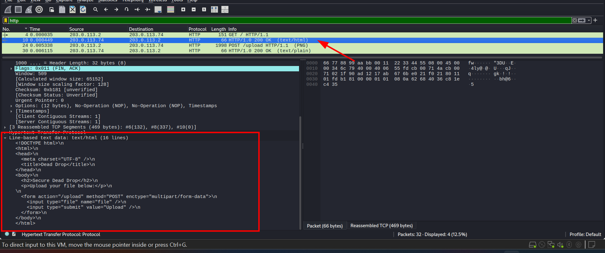

It's a very simple form for uploading a file. Presumably, that's what the POST was for. Let's look at the contents of the POST:

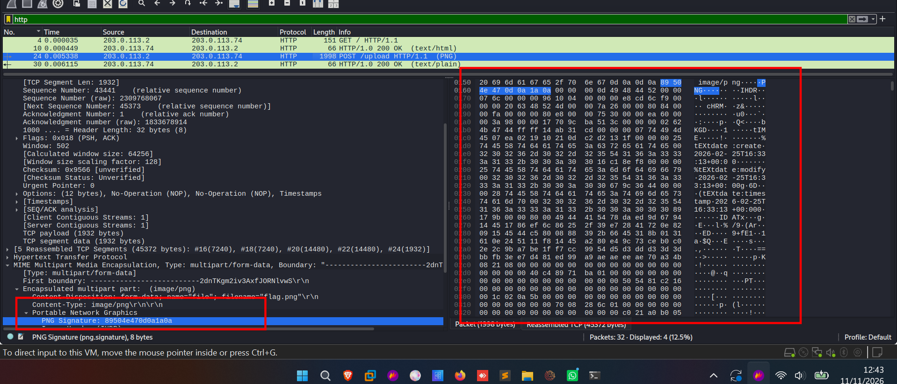

We see some form-data with the filename flag.png. Presumably, this is our flag. We'll need to extract it. There are a few methods of approaching this.

***Extracting flag.png via Export Objects***

Wireshark has a built-in facility for extracting data from HTTP requests. This sort of works for our purposes. I'll demonstrate:

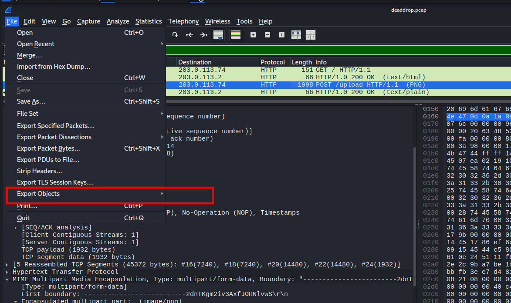


We can save the multipart/form-data as a PNG file, but it won't open. Why? If we open it in a hex or text editor, we'll see that it's because the form data delimiters are still present:

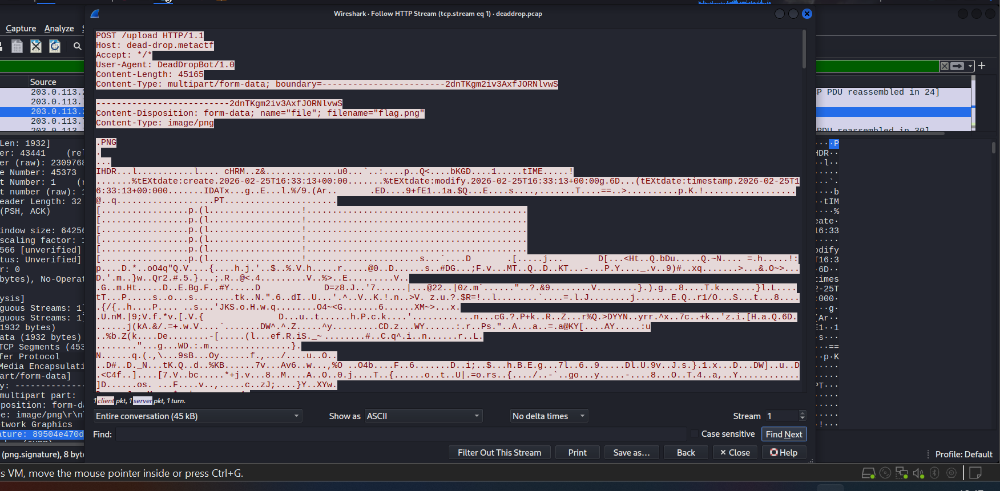

We could use a tool like binwalk to get at the PNG within, but for something this simple, we can just remove the first few lines, making sure to put the PNG magic bytes right at the start of the file:

***Extracting flag.png via Copy Bytes***

This is a more generalizable method that will work for non-HTTP protocols. The downside is that it makes use of your clipboard, which can be finicky.

Open up the protocol hierarchy (bottom left pane) and find Portable Network Graphics. Make sure that when you click it, on the right, it highlights only from the start of the actual PNG data, not the MIME type or other such metadata.

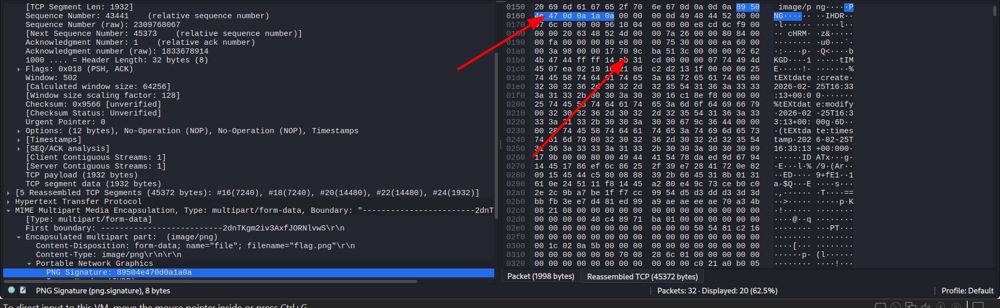

Right click it, Copy, as Raw Binary:

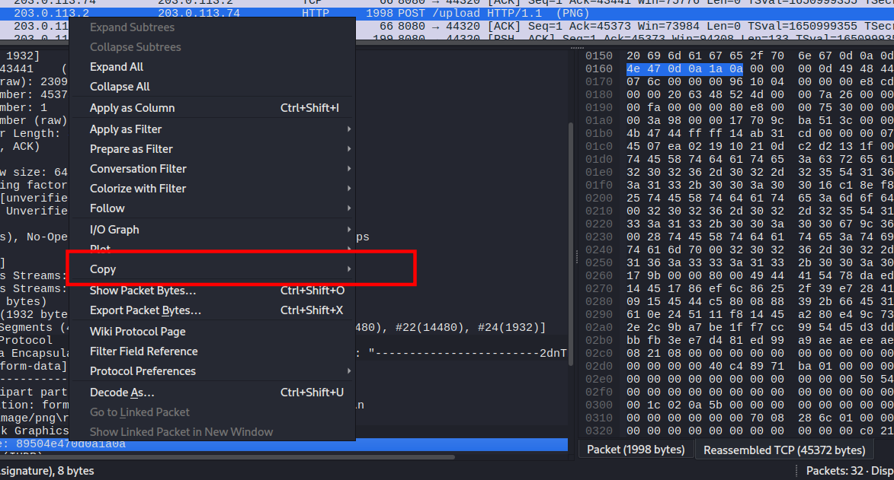

And now, if your OS' clipboard cooperates, paste it anywhere on your disk:


***Opening flag.png via Show Packet Bytes***

And finally, we saved the best method for last, because it took the author way too long to realize this works.

Right click the Portable Network Graphics item again. This time, choose Show Packet Bytes.

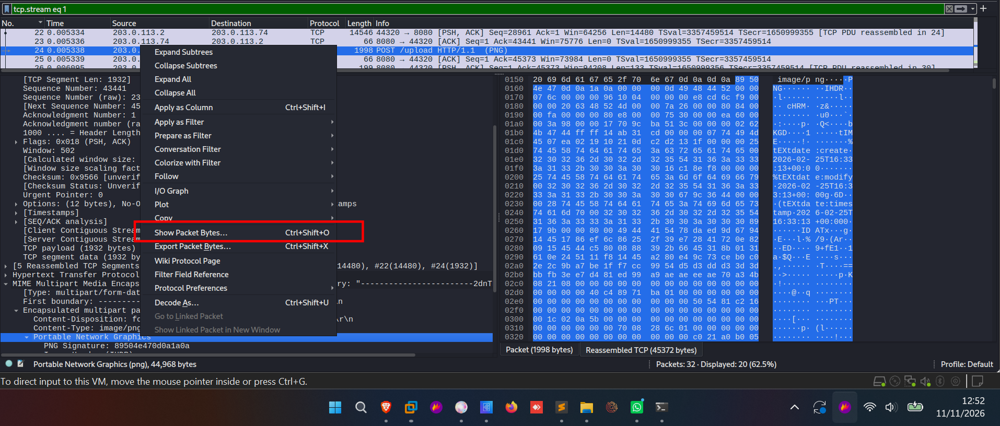

And lo and behold:

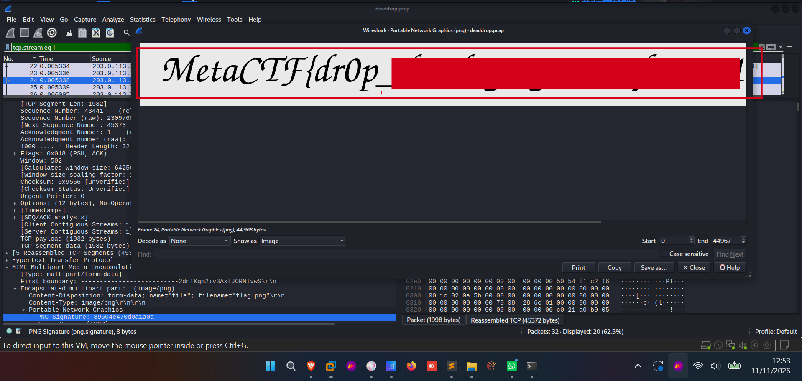

This was an amazing learning lab. Very great.


