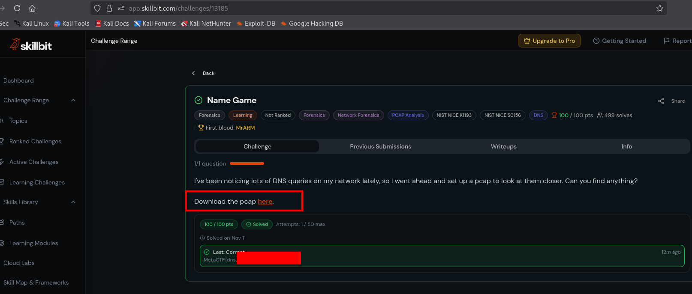
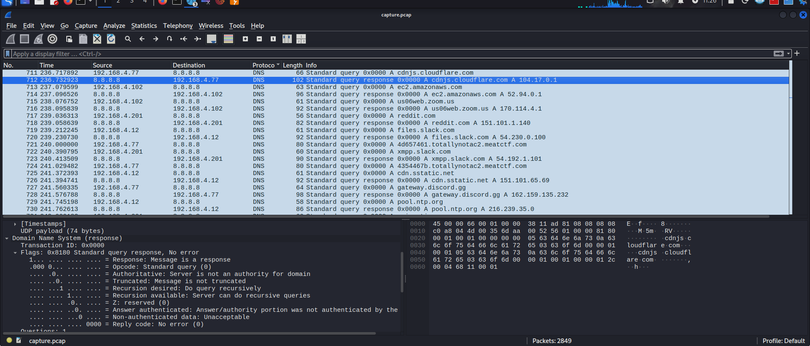
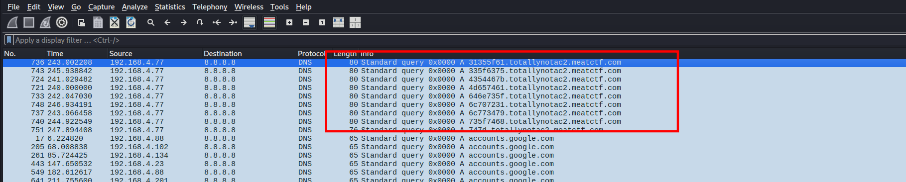
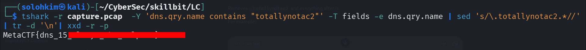

### NAME - GAME CTF ### -Skill bit
 
 we start by getting the pcap file




Overview

A single packet capture: capture.pcap. A suspicious workstation was generating unusual DNS traffic, and we need to figure out what was exfiltrated.

***Reconnaissance***

We can see the below pcap file image



Open capture.pcap in Wireshark. At first glance it looks like a normal pcap of random DNS queries for Google, GitHub, Discord, etc. But scrolling through the DNS queries, one domain stands out immediately:
```bash
4d657461.totallynotac2.meatctf.com
4354467b.totallynotac2.meatctf.com
646e735f.totallynotac2.meatctf.com
```



The base domain totallynotac2.meatctf.com is obviously suspicious. The subdomain prefixes — 4d657461, 4354467b, 646e735f — all look like hex strings.

***What is this?***

This is DNS exfiltration: a classic data exfiltration technique where an attacker encodes stolen data into DNS subdomain queries. Since DNS is almost never blocked or inspected (firewalls let it through, IDS rarely flags it), it's a stealthy channel for smuggling data out of a network.

The attacker's tool on the compromised machine:

    Hex-encoded the stolen data
    Split it into 8-character chunks
    Sent one DNS query per chunk, using each chunk as a subdomain prefix
    Their C2 server logged the incoming queries and reassembled the data


***Recovering the data***

We can view what was in the hex with a simple bash one-liner using tshark:

we can use the tshark command as below:

```bash
tshark -r capture.pcap \
  -Y 'dns.qry.name contains "totallynotac2"' \
  -T fields -e dns.qry.name \
  | sed 's/\.totallynotac2.*//' \
  | tr -d '\n' \
  | xxd -r -p
```
<table style="width:100%; border-collapse: collapse; border: 1px solid #00ff00;">
  <tr>
    <th style="border: 1px solid #00ff00; padding: 8px; text-align: left;">Code</th>
    <th style="border: 1px solid #00ff00; padding: 8px; text-align: left;">Explanation</th>
  </tr>
  <tr>
    <td style="border: 1px solid #00ff00; padding: 8px;"><code>tshark -r capture.pcap</code></td>
    <td style="border: 1px solid #00ff00; padding: 8px;">Reads the packet capture.</td>
  </tr>
  <tr>
    <td style="border: 1px solid #00ff00; padding: 8px;"><code>-Y 'dns.qry.name contains "totallynotac2"'</code></td>
    <td style="border: 1px solid #00ff00; padding: 8px;">Applies a Wireshark display filter.</td>
  </tr>
  <tr>
    <td style="border: 1px solid #00ff00; padding: 8px;"><code>-T fields -e dns.qry.name</code></td>
    <td style="border: 1px solid #00ff00; padding: 8px;">Outputs selected fields and prints the queried domain names.</td>
  </tr>
  <tr>
    <td style="border: 1px solid #00ff00; padding: 8px;"><code>sed 's/\.totallynotac2.*//'</code></td>
    <td style="border: 1px solid #00ff00; padding: 8px;">Strips the domain suffix.</td>
  </tr>
  <tr>
    <td style="border: 1px solid #00ff00; padding: 8px;"><code>tr -d '\n'</code></td>
    <td style="border: 1px solid #00ff00; padding: 8px;">Removes newlines to join the hex.</td>
  </tr>
  <tr>
    <td style="border: 1px solid #00ff00; padding: 8px;"><code>xxd -r -p</code></td>
    <td style="border: 1px solid #00ff00; padding: 8px;">Converts hex back to data.</td>
  </tr>
</table>




Glad you enjoyed it.